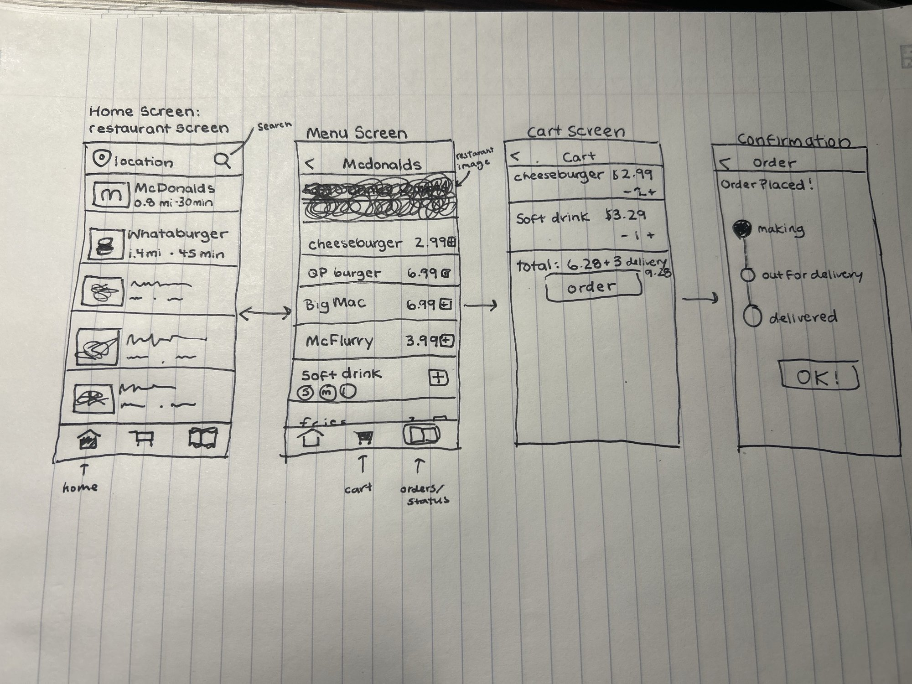

Original App Design Project - README
===

# DeliverEagle

Submitted by: **Taha**

## Table of Contents

1. [Overview](#Overview)
2. [Product Spec](#Product-Spec)
3. [Build Progress](#Build-Progress)
4. [Wireframes](#Wireframes)
5. [Schema](#Schema)

## Overview

### Description

DeliverEagle is a simple food-delivery app, like a basic version of Uber Eats. Users can browse restaurants, view a restaurant's menu, add items to a cart, place an order, and follow the order's status until it arrives.

### App Evaluation

- **Category:** Food & Drink / Lifestyle
- **Mobile:** Uses a map to show the restaurant and delivery progress, push notifications for order updates, and location to show nearby restaurants. These make it more than a website.
- **Story:** Order food in a few taps and know when it's coming. The value is immediately clear to anyone who has used a delivery app like Uber Eats.
- **Market:** Anyone who orders takeout, with a focus on college students living on or near campus.
- **Habit:** Users open the app whenever they're hungry, often several times a week, to browse, order, and check order status.
- **Scope:** The MVP uses mock restaurant and menu data and a simulated checkout, with no user accounts, real payments, or real drivers. Even this stripped-down version is a complete, interesting app to build.

## Product Spec

### 1. User Stories (Required and Optional)

**Required Must-have Stories**

* User can view a list of restaurants.
* User can tap a restaurant to see its menu items with prices.
* User can add and remove menu items in a cart and see the order total.
* User can place an order from the cart (simulated checkout).
* User can view the status of their current order (Making → Out for delivery → Delivered).

**Optional Nice-to-have Stories**

* User can see the restaurant and delivery progress on a map.
* User receives a push notification when the order status changes.
* User can see restaurants sorted by distance from their location.
* User can search or filter restaurants by cuisine.
* User can view past orders and reorder.

### 2. Screen Archetypes

- [ ] **Restaurant List (Home) Screen**
    * User can view a list of restaurants.
- [ ] **Restaurant Menu Screen**
    * User can tap a restaurant to see its menu items with prices.
    * User can add items to the cart.
- [ ] **Cart Screen**
    * User can add and remove menu items and see the order total.
    * User can place an order (simulated checkout).
- [ ] **Order Status (Confirmation) Screen**
    * User can view the status of their current order.

### 3. Navigation

**Tab Navigation** (Tab to Screen)

* Home (Restaurant List)
* Cart
* Orders (Order Status)

**Flow Navigation** (Screen to Screen)

- [ ] **Restaurant List (Home) Screen**
  * => Restaurant Menu Screen (tap a restaurant)
- [ ] **Restaurant Menu Screen**
  * => Cart Screen (tap "View Cart")
  * => back to Restaurant List
- [ ] **Cart Screen**
  * => Order Status Screen (tap "Order")
- [ ] **Order Status (Confirmation) Screen**
  * => Restaurant List (tap "OK!")

## Build Progress

### Sprint 1 (Unit 8)

**Required features**

- [x] User can view a list of restaurants.
- [x] User can tap a restaurant to see its menu items with prices.
- [x] User can add and remove menu items in a cart and see the order total.
- [x] User can place an order from the cart (simulated checkout).
- [x] User can view the status of their current order (Making → Out for delivery → Delivered).

**Optional features**

- [x] User can search or filter restaurants by cuisine.
- [ ] User can see the restaurant and delivery progress on a map.
- [ ] User receives a push notification when the order status changes.
- [ ] User can see restaurants sorted by distance from their location.
- [ ] User can view past orders and reorder.

**Additional features**

- [x] Drinks can be ordered in sizes (S / M / L).
- [x] The Cart tab shows a badge with the number of items in the cart.

### Video Walkthrough

https://imgur.com/a/POe0t5x

## Wireframes

### [BONUS] Digital Wireframes & Mockups

### [BONUS] Interactive Prototype

## Schema

[This section will be completed in Unit 9]

### Models

[Add table of models]

### Networking

- [Add list of network requests by screen ]
- [Create basic snippets for each Parse network request]
- [OPTIONAL: List endpoints if using existing API such as Yelp]
